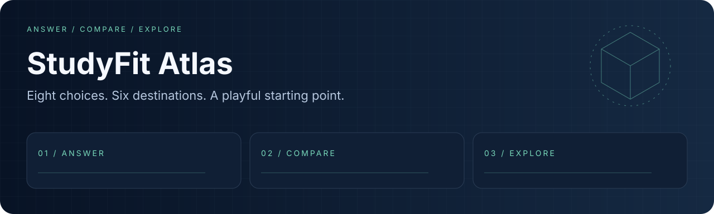
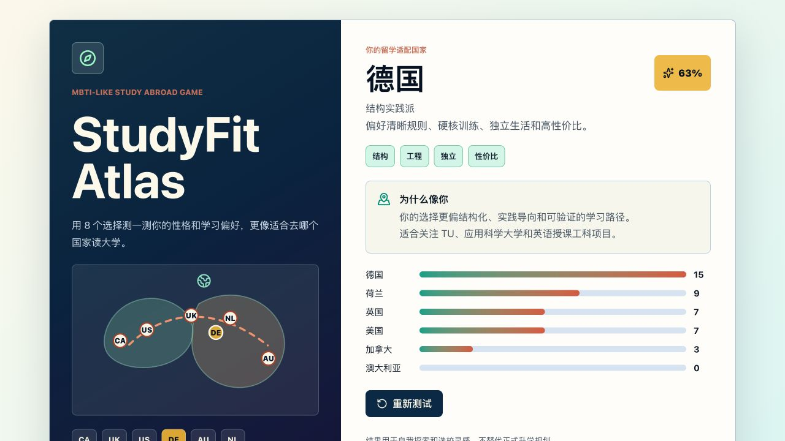

<div align="center">
  
  <h1>StudyFit Atlas</h1>
  <p><strong>八个选择，六个目的地，从自我探索开始。</strong></p>
  <p><a href="LICENSE"></a> <a href="docs/readme/validation.md"></a></p>
  <p><a href="#overview">项目亮点</a> · <a href="#quick-start">快速开始</a> · <a href="#workflow">工作流</a> · <a href="#validation">验证</a> · <a href="#documentation">文档</a></p>
  <p><a href="README.md">English</a> · <a href="README.zh-CN.md">简体中文</a></p>
</div>

---

<a id="overview"></a>
## 项目亮点

纯浏览器学习偏好问答，采用确定性加权评分并支持重置，是独立的 React 示例项目。

| 能力 | 内容 |
| :--- | :--- |
| **八道问题** | 课堂、节奏、校园、沟通和个人偏好。 |
| **六国画像** | 加拿大、英国、美国、德国、澳大利亚和荷兰。 |
| **无需后端** | 应用全部运行在浏览器。 |

### 本地演示



*本轮本机截图；示例数据、回放与 fallback 模式见下方说明。*

<a id="quick-start"></a>
## 快速开始

```bash
git clone https://github.com/eust-w/studyfit-atlas.git
cd studyfit-atlas
npm ci
npm run dev
# Open the local URL printed by Vite.
```

<a id="workflow"></a>
## 工作流

```text
ANSWER → COMPARE → EXPLORE
```

```bash
npm test -- --run
npm run build
npm run preview
```

<a id="validation"></a>
## 验证

```bash
npm test -- --run
npm run build
```

运行环境与已执行结果见 [validation notes](docs/readme/validation.md).

| 项目 | 当前边界 |
| :--- | :--- |
| 评分 | 百分比是游戏评分，不是录取概率或经验证的人格测评。 |
| 用途 | 用于自我探索与规划灵感；真实留学决策需要独立核实。 |

<a id="documentation"></a>
## 文档

- [Scoring model / 评分模型](src/quiz.ts)
- [Scoring tests / 评分测试](src/quiz.test.ts)
- [Interaction tests / 交互测试](src/App.test.tsx)

## 许可证与来源

原创代码和新增演示资源采用 [Apache-2.0](LICENSE). 第三方代码、模型、数据和外部资源保留各自许可，详见 [THIRD_PARTY_NOTICES.md](THIRD_PARTY_NOTICES.md).
